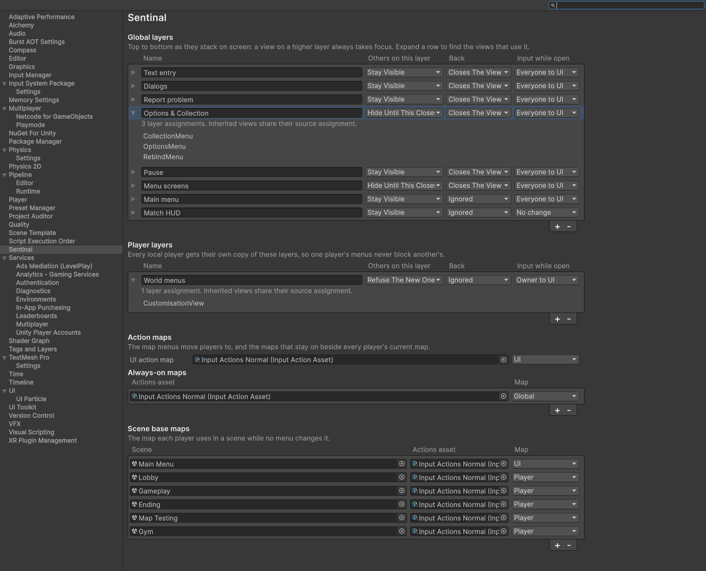
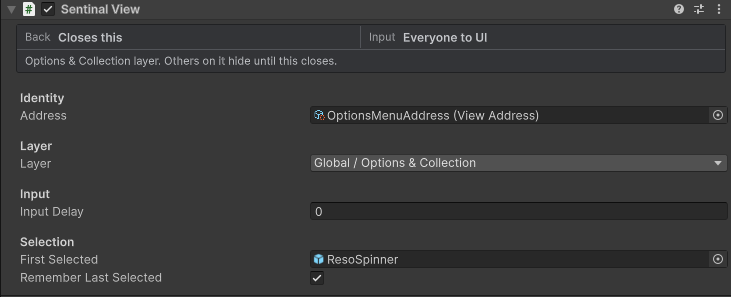
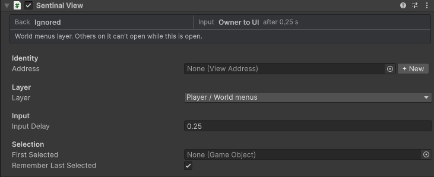
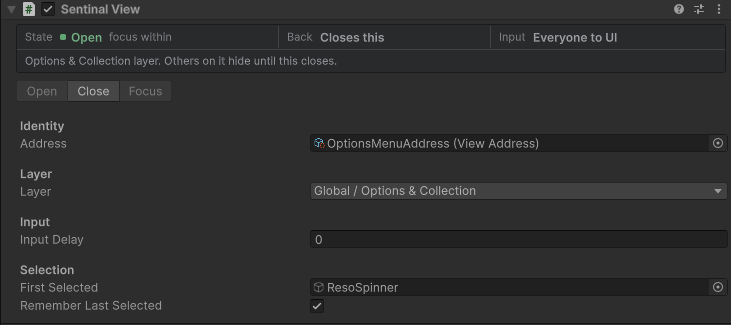
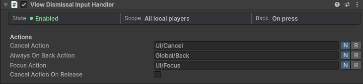
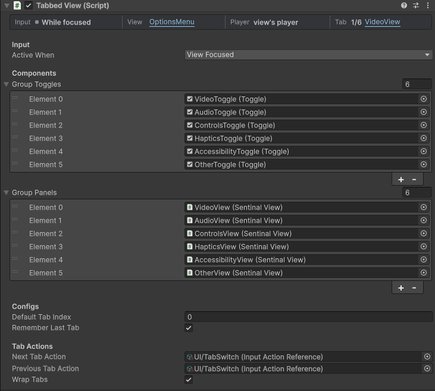
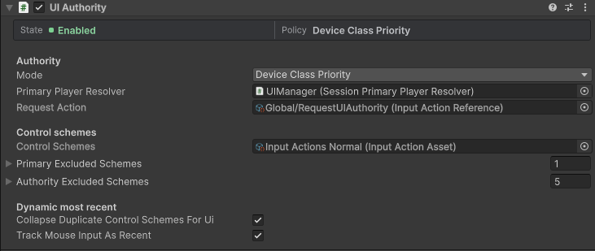
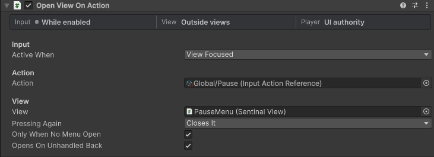
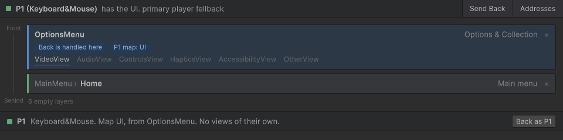

# Sentinal component reference

Every component, setting and rule in Sentinal 6. For an overview with screenshots, start with the [README](../README.md).

- [Settings and layers](#settings-and-layers)
- [SentinalView](#sentinalview)
- [Back](#back)
- [Tabs](#tabs)
- [Transitions](#transitions)
- [Addresses and links](#addresses-and-links)
- [Players and UI authority](#players-and-ui-authority)
- [Action maps](#action-maps)
- [Input components](#input-components)
- [Text prompts](#text-prompts)
- [Sentinal Monitor](#sentinal-monitor)

## Settings and layers

**Project Settings › Sentinal** edits one `SentinalSettings` asset. **Create Sentinal Settings** makes it at the default path and adds it to Preloaded Assets, so builds load it too.



There are two ordered lists. Both run top to bottom, the way views stack on screen.

- **Global layers** are shared, and the [UI authority](#players-and-ui-authority) player drives them. A view on a higher layer always takes focus from a lower one. Within one layer, the newest view is in front.
- **Player layers** are copied for every local player. One player's stack never blocks another's, and Global and Player layers are never compared.

Expand a layer row to find where its assignments are authored. Inherited prefab copies and nested tabs share the source entry, and saved scene assignments are grouped by scene. Hover an entry for its full path, or click it to select the source. Clicking the summary at the top of a view's Inspector opens this page with that view's layer expanded.

| Setting | Values |
| --- | --- |
| **Others on this layer** | **Stay visible**: older views lose focus but stay on screen. **Hide until this closes**: older views turn off and come back when this one closes. **Close**: older views close. **Refuse the new one**: while a view is open on this layer, opening another one fails. |
| **Back** | **Closes the view**, or **Ignored** for views only code should close, such as a main menu root or a HUD. |
| **Input while open** | **No change**. **Everyone to UI**: every registered player switches to the UI map, and Player-layer views are suspended. **Owner to UI**: only the view's owner switches. |

A view refers to its layer by a stable ID, so renaming or reordering layers never breaks a view.

## SentinalView



The status panel shows Back, input and the layer description together. Click the layer description, Back or Input to open that layer in Project Settings. In Play Mode it also shows the live state, transition progress and focus. Open, Close and Focus controls appear below it.

| Field | Meaning |
| --- | --- |
| **Address** | Optional `ViewAddress` key. See [Addresses and links](#addresses-and-links). |
| **Layer** | Required on top-level views. Nested views have no layer of their own: they belong to the nearest `SentinalView` above them in the hierarchy. |
| **Input Delay** | Top-level views only. Unscaled seconds to ignore input every time the view, or a view inside it, gets input back. Use it for views that can pop up while players are still pressing buttons. Nested views use their window's delay. |
| **First Selected** | Selected whenever the view gains focus. When it's empty, nothing is selected. |
| **Remember Last Selected** | Returns to the last selected element instead of First Selected when the view regains focus. |



Input Delay belongs to each top-level view, so views on the same layer can wait for different amounts of time. The timer restarts when the view or a nested panel regains input and runs while the game is paused. A nested panel's own Input Delay is not used.

### State



A view is always in exactly one state: `Closed`, `Opening`, `Open`, `Closing` or `Hidden`.

- `IsOpen` is true while Opening, Open or Hidden.
- `IsShown` is true while Opening or Open.
- `Opened` and `Closed` fire once per open. `Closed` also fires when a parent closes or the object is destroyed.
- `InputChanged` fires when the view gains or loses the ability to take input.

Sentinal owns `SetActive` for views. Open and close them through the API below. Toggling a view's GameObject directly logs a warning that names `Open()` / `Close()`.

### API

| Member | Use |
| --- | --- |
| `Open()` / `OpenAsync()` | Opens a Global-layer or nested view. Returns false if the layer refuses it. |
| `Open(PlayerInput owner)` / `OpenAsync(owner)` | Opens a Player-layer view for one player. |
| `Close()` / `CloseAsync()` | Closes the view and everything nested in it. The async version waits for transitions. |
| `BringToFront()` | Moves an open view to the front of its layer. |
| `IsCurrent()` | True when this view has focus. |
| `Owner`, `InputPlayer` | The owning player for Player views, and the player whose input this view reads. |
| `CanProcessInput(action)` | True when the view has input, its delay has passed and the action was pressed fresh. |
| `SetFirstSelected(target, selectImmediately)` | Changes First Selected at runtime. |
| `InputDelay` | Reads or changes the Input Delay. |
| `SelectNothing` | Clears selection on focus even when First Selected is set. |

`SentinalViewRouter` answers questions about the whole UI: `CurrentView`, `CurrentWindow`, `GetPlayerView(player)`, `AnyViewsOpen()`, `GlobalUIOpen()`, `CanOpen(layer, owner)`, `GetOpenViews()`, and the events `ViewOpened`, `ViewClosed`, `OnSwitch` and `Changed`.

## Back

A Back press starts at the focused view and works upward:

1. If the view has an `IBackHandler` that returns `true`, the press is consumed.
2. Otherwise, a tab hands Back to its window, and any other nested view closes.
3. A top-level view follows its layer: it closes, or Back is ignored.

`SentinalViewRouter.PreviewBack()` (or `PreviewBack(player)`) returns a `BackPreview` that says what a press would do now (`Nothing`, `Handler`, `Closes` or `Ignored`) and which view it applies to. Use it to show or hide a Back prompt.

Calling `Close()` from code never runs `IBackHandler`.

### ViewDismissalInputHandler

Put one in each scene. It listens on every registered player's own action asset:



| Action | Default | Role |
| --- | --- | --- |
| **Cancel** | `UI/Cancel` | Back while the UI map is on. |
| **Always-on Back** | `Global/Back` | Back from any map, including gameplay. When there's nothing to go back from, it opens the view whose `OpenViewOnAction` has **Opens On Unhandled Back**, for example Escape opening Pause. |
| **Focus** | `UI/Focus` | Selects the current view again for the authority player, after a mouse click has cleared the selection. |

Each player's Back goes to the front Global view if the player has UI authority. Otherwise it goes to that player's own Player-layer stack, so one player can never close another player's menu. A control bound to both Cancel and the always-on Back is only handled once. An action missing from a player's asset is turned off for that player, without an error.

## Tabs



`TabbedView` goes on or below its window view.

- **Group Toggles** and **Group Panels** are matching lists. Each panel must be a `SentinalView` nested directly in the window.
- **Default Tab Index** and **Remember Last Tab** pick the tab that opens with the window.
- **Next Tab Action**, **Previous Tab Action** and **Wrap Tabs** set up shoulder-button switching. Both can be the same 1D axis action, with the negative half moving back.
- **Active When** works the same way as on [input components](#input-components). With **View focused**, a popup inside the window stops tab switching.

From code, use `SelectTab(panel)`, `SelectTab(index)`, `Next(wrap)` and `Previous(wrap)`. `SelectTab(panel)` also works from a uGUI button event.

## Transitions

Derive from `ViewTransition` and put it on the view:

```csharp
public abstract Awaitable PlayAsync(bool show, CancellationToken token);
public abstract void Snap(bool show);
```

Sentinal turns the GameObject on before showing and off after hiding. If a transition is interrupted, Sentinal cancels it and plays it the other way, starting from where it stopped. **Input Waits For Transition** holds input until opening finishes. **Animate When Hidden** also plays the transition when a layer hides or restores the view.

`CanvasGroupFade` is included. It needs an assigned CanvasGroup, a **Duration** in unscaled seconds (so it runs while the game is paused) and an optional **Hidden Scale**.

## Addresses and links

A `ViewAddress` is a ScriptableObject key. It lets a view in one prefab be opened from another without a direct reference.

- Assign it to a view's **Address** to register the view with `ViewAddressRegistry`.
- `ViewLink` on a button opens the view at an address.
- `SentinalViewRouter.OpenView(address)` / `OpenViewAsync(address)` opens it from code.
- If no scene instance exists, the address can create one: **Scene only**, from a **Prefab**, or from an **Addressable** prefab. The Addressable option needs `com.unity.addressables`.

## Players and UI authority



Add one `UIAuthority` to a scene that persists. It decides which local player drives Global layers.

| Field | Meaning |
| --- | --- |
| **Mode** | **Primary player**: the player your game names as primary. **Dynamic most recent**: whoever used an input last. **Explicit authority request**: only the Request action changes it. **Device class priority**: each device class has one representative player, and using that class gives them the UI. Request makes a different player the representative. |
| **Primary Player Resolver** | Required. A component in your game that implements `IPrimaryPlayerResolver` and returns the primary player, or null. |
| **Request Action** | Optional. Looked up on each player's own action asset. A player whose asset doesn't have it simply can't request. |
| **Control Schemes** | The asset whose schemes fill the two exclusion lists. |
| **Primary / Authority Excluded Schemes** | Schemes that can't be primary, or whose input can't take authority. |
| **Collapse Duplicate Control Schemes**, **Track Mouse Input As Recent** | Fine-tune Dynamic most recent. Mouse motion never takes authority; clicks and scroll can. |

Read the result through `UIAuthority.Current`, `Primary` and `MostRecent`. The events are `CurrentChanged`, `PlayersChanged` and `PointerInputChanged`. Input from inside a player's own menu never takes Global authority. Global actions, such as Pause or Request, still can.

## Action maps

`PlayerInputMaps` is the only thing that should switch action maps. Register each `PlayerInput` with `PlayerInputMaps.Register` and remove it with `Unregister`. In settings, configure:

- **UI action map**: the map players switch to when a layer moves them to UI.
- **Always-on maps**: maps that stay on beside every player's current map, such as a Global map with Pause and Back.
- **Scene base maps**: the map each player uses in a scene while no view changes it.

Map changes are worked out together after views open and close, so closing one menu and opening another in the same frame never switches to gameplay in between. The UI input module's actions follow the current UI authority player. Subscribe to `BeforeApply` to react just before a player's map changes.

## Input components



Every input component finds its player through its nearest view. Outside a view, it uses the UI authority player. The shared status panel shows the listening rule, nearest view and player source. In Play Mode it shows the resolved player and whether input is active. Click a view name to select it. `TabbedView` also shows the selected tab.

- **Active when › View focused** listens while the view or one of its tabs has focus. A popup on top stops it.
- **Active when › View open** listens whenever the view is shown, even without focus.
- A press that started before the component could listen never fires, whether it was held across a view opening, a popup closing, an owner change or an authority change. The player must press again.
- `SetPlayer(player)` pins a specific player, who then stays fixed across authority changes.

| Component | Settings |
| --- | --- |
| `OpenViewOnAction` | **Action**, **View**, **Pressing Again** (does nothing / closes it), **Only When No Menu Open** (won't open over a Global view that moves everyone to UI), **Opens On Unhandled Back** (one per scene). It never opens below the focused view's layer, or in a frame where Back is being handled. |
| `InputActionButton` | **Action**, **Send Pointer Events** (button visuals and reselection), **Select Button On Input Action**, **Defer Execution** (clicks next frame, so the press can't carry into a view it opens), **Trigger On Release**. It only clicks a `Button` that is enabled and interactable. |
| `InputActionButtonHold` | Clicks when a Hold interaction completes, and raises hold started, cancelled and completed events for progress UI. |
| `DisplayInputString` | Writes the binding text for the player's current control scheme into a TextMeshPro label, with a prefix and suffix. |
| `InputActionSelector` | A serializable action reference that is looked up on the player's own action asset, so it works with cloned assets and rebinds. |

## Text prompts

`PromptedTextField` asks for text through `TextInputGateway`. Your game provides an `ITextInputGateway`, such as an on-screen keyboard window, and `TextInputPrompt` carries the prompt data. Sentinal doesn't include any prompt UI.

## Sentinal Monitor



**Window › Sentinal › Monitor** works in Play Mode.

- The header shows who has UI authority and why.
- The stack lists open Global views front to back. Each card shows the layer, the focus, what Back does, the map change it causes, and its tabs.
- Each player has a row with their scheme, current map, and the view that caused it. Their own Player-layer views are listed there too.
- **Send Back** and **Back as P1…** press Back without a controller. **Addresses** lists the registered `ViewAddress` keys.
