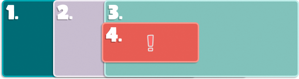
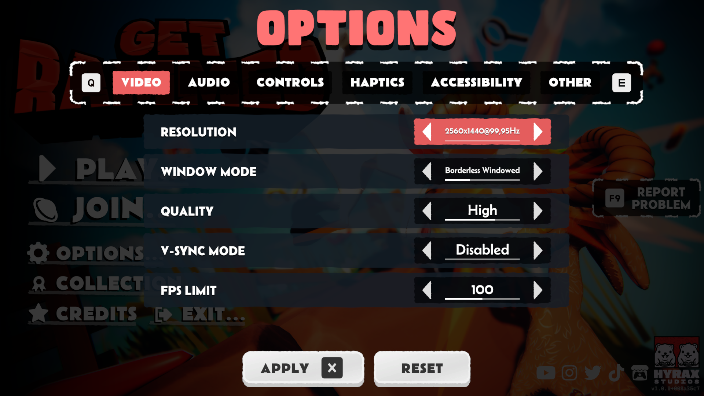
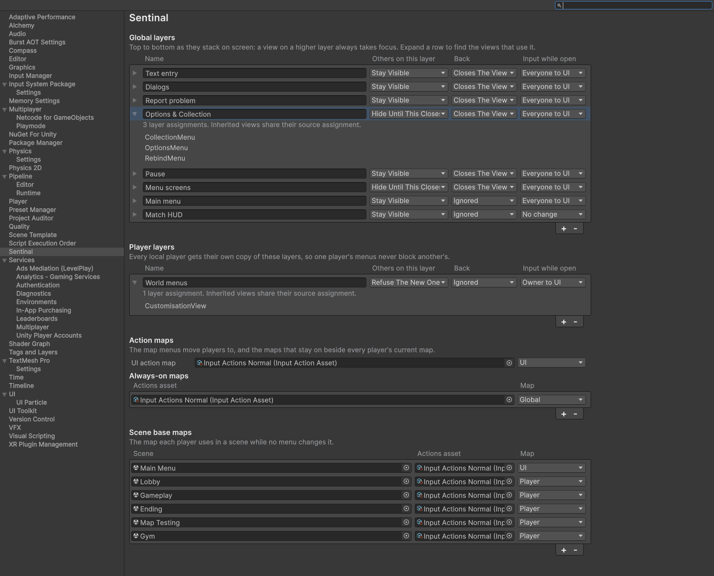
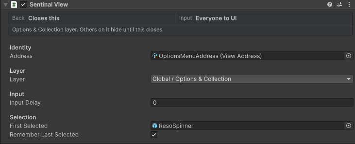
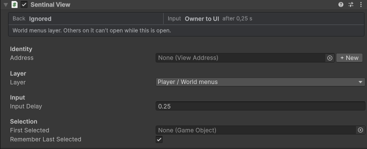
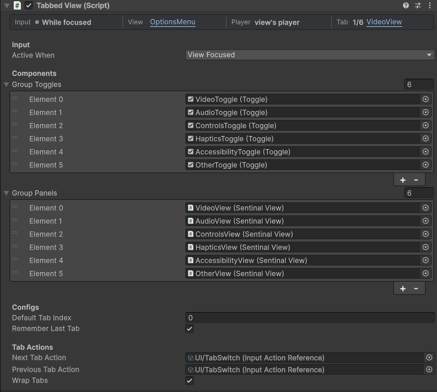
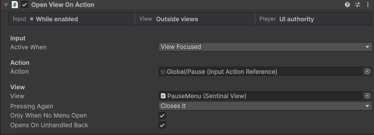
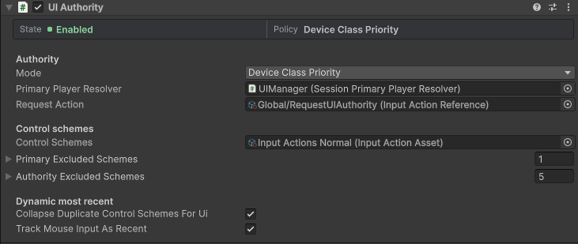
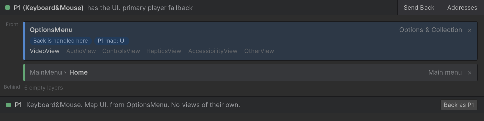

<p align="center">
  
</p>

<h1 align="center">Sentinal</h1>

<p align="center">
  <b>Menus, dialogs and local-player UI for Unity, sorted into layers.</b><br>
Back follows the view hierarchy, focus follows the layers, and each local player can open their own menus.
</p>

<p align="center">
  
  
  
  <a href="LICENSE.md"></a>
</p>



<sub>The Options menu in [GET RAMMED](https://store.steampowered.com/app/4612760/GET_RAMMED/). It uses the Options & Collection layer and holds six tabs. Sentinal handles tab switching, Back, focus and player ownership. This capture shows keyboard prompts; paired controllers use their own bindings.</sub>

## Why Sentinal

Most menu code ends up answering the same questions over and over. What's on top? What does Back close? Who is allowed to press buttons right now? Sentinal answers them once, in **Project Settings**, so your menus don't have to.

- **Layers instead of priorities.** List layers such as Dialogs, Pause, Main menu and Match HUD top to bottom, front to back. Each layer decides what happens to other views on that same layer, what Back does, and whose input moves to UI.
- **One component per menu.** Add a `SentinalView`, choose a layer, and set its initial selection. Set Input Delay on the individual view when it needs protection from button presses as it opens.
- **Back that follows the hierarchy.** Popups close first, tabs hand Back to their window, and windows close or ignore Back based on their layer. Custom logic plugs in with `IBackHandler`.
- **Local multiplayer.** Player layers give every local player their own menu stack. `UIAuthority` decides which player drives the shared menus.
- **One owner for action maps.** `PlayerInputMaps` moves players between gameplay and UI maps based on what's open.
- **Async open and close.** `OpenAsync` / `CloseAsync` with cancellable transitions. `CanvasGroupFade` is included.
- **A live Monitor.** See every open view, its layer, what Back will do, and which map each player is on.

## Install

Sentinal needs **Unity 6.0 or later**, the **Input System** and **uGUI**.

In **Window › Package Manager**, click **+ › Install package from git URL** and paste:

```
https://github.com/Tirtstan/Sentinal.git
```

To pin a version, add a tag: `https://github.com/Tirtstan/Sentinal.git#v6.0.0`.

## Quick start

1. **Create settings.** Open **Project Settings › Sentinal** and click **Create Sentinal Settings**. Sentinal adds the asset to Preloaded Assets for you.
2. **Define your layers.** Add Global layers top to bottom, the way they stack on screen. Pick the UI action map and a base map for each scene.
3. **Add a view.** Put a `SentinalView` on each screen or panel, and pick a layer for the top-level ones.
4. **Open it.** Call `view.Open()` from a button, or add `OpenViewOnAction` to bind it to an input action.
5. **Add the input owners once per scene.** Add one `UIAuthority` and one `ViewDismissalInputHandler`, and register each `PlayerInput` with `PlayerInputMaps`.



Each layer has three settings. Expand a row to find where its assignments are authored. Nested tabs and inherited prefab copies share their source entry; hovering an entry shows its full path.

| Setting | What it decides |
| --- | --- |
| **Others on this layer** | What happens to a view already open on this layer: it stays visible, hides until the new one closes, closes, or refuses the new one. |
| **Back** | Whether Back closes a top-level view on this layer, or is ignored, as on a main menu. |
| **Input while open** | No change, everyone to UI, or only the owner to UI. |

## Views



The compact status panel shows what Back does here, whose input the view takes, and its layer's behaviour. Click the layer description, Back or Input to edit that layer in Project Settings. In Play Mode, the same panel adds the live state and focus, with Open, Close and Focus controls below it.

A view has these fields:

- **Layer**, for top-level views. Nested views belong to the nearest view above them in the hierarchy.
- **Input Delay**, for top-level views that can pop up while players are still pressing buttons, like a menu you walk into. It ignores input for that many seconds each time the view gets input back. Nested views use their window's delay.
- **First Selected**, chosen when the view gains focus. Leave it empty to select nothing.
- **Remember Last Selected**, which returns to the previous selection instead.
- **Address**, which is optional. It lets other prefabs find and open the view through `ViewAddressRegistry` or `ViewLink`.

Closing a view also closes everything inside it. `Opened` and `Closed` fire once per open, even when a parent closes the view or the scene unloads.



This world menu waits 0.25 seconds whenever it gets input back. Another view on the same layer can use a different delay. Nested panels use their top-level window's delay, and the timer still runs while the game is paused.

## Tabs



`TabbedView` pairs toggles with panel views nested under the same window. It handles next and previous tab actions, wrapping, the default tab and **Remember Last Tab**. Tabs keep switching while focus is on a tab. A popup inside the window blocks switching until it closes.

## Input that follows its view



Input components find their player from the nearest view, so you never wire a player into a button. **Active when** chooses whether they listen while the view is **focused** (tabs count, popups don't) or whenever it's **open**. A button held before a view gets input back never fires; the player has to press it again.

Their status panels share the view Inspector's styling. They show the input rule, nearest view and player source; in Play Mode they show the resolved player and whether the component is listening. View names are links that select the referenced object. Tabs also show the selected panel.

| Component | Use it for |
| --- | --- |
| `OpenViewOnAction` | Opening a view from an action, like Pause on Start/Escape. It can close the view on a second press and open it when Back has nothing to close. |
| `InputActionButton` | Clicking a uGUI `Button` from an action, like X for Apply. |
| `InputActionButtonHold` | Holding to confirm, with start, cancel and complete events. |
| `DisplayInputString` | Showing the current binding for the player's device. |
| `PromptedTextField` | Sending text entry to your own prompt UI, such as a Steam Deck keyboard. |

## Local players



**Global** layers are shared: the player with **UI authority** drives them. **Player** layers are personal: open them with `view.Open(playerInput)`, and that player's menus never block anyone else's. When a Global menu moves everyone to UI, Player menus pause and come back exactly where they were.

`UIAuthority` has four ways to pick the authority player:

- **Primary player**: always the player your game names as primary.
- **Dynamic most recent**: whoever last used an input.
- **Explicit authority request**: only a dedicated Request action changes it.
- **Device class priority**: each device class (keyboard, gamepad…) has one representative player, and using that class gives them the UI. Request makes a different player the representative.

## Sentinal Monitor



**Window › Sentinal › Monitor** shows the live view stack front to back. For each view you see its layer, what Back does, and the maps each player is on. You can also send Back as any player from there.

## Scripting

```csharp
using Sentinal;

[SerializeField] private SentinalView pause;
[SerializeField] private SentinalView customise;

pause.Open();                       // Global layer, driven by the UI authority player
customise.Open(playerInput);        // Player layer, owned by one player
await pause.CloseAsync();           // waits for its transition

pause.Closed += OnPauseClosed;
SentinalView top = SentinalViewRouter.CurrentView;
BackPreview back = SentinalViewRouter.PreviewBack(); // what Back would do right now
```

To run your own logic on Back, implement `IBackHandler` on the view's GameObject. Return `true` to consume the press:

```csharp
public class UnsavedChangesBack : MonoBehaviour, IBackHandler
{
    [SerializeField] private SentinalView confirmDiscard;

    public bool TryHandleBack()
    {
        if (!HasUnsavedChanges)
            return false;    // let the view close normally

        confirmDiscard.Open();
        return true;
    }
}
```

For a custom transition, derive from `ViewTransition` and implement `PlayAsync(show, token)` and `Snap(show)`.

## Learn more

- **[Component reference](Documentation~/Components.md)** covers every component, setting and rule in detail.
- **The sample**: import **Layers and local players** from the Package Manager's Samples tab. It has a screen, a dialog, tabs, two local player menus and a fade, in one scene with no game code.
- **Directional navigation** (stick and D-pad between buttons) lives in the separate [Compass](https://github.com/Tirtstan/Compass) package.

## Upgrading from 5.x

6.0 is a breaking release, and there's no automatic migration. For each menu:

1. Replace `ViewSelector` with `SentinalView`.
2. Replace its priority, group, hide-others, root and `ActionMapGate` settings with a layer that has the same behaviour.
3. Make nested panels children of the view that owns them, and open and close them with `Open()` / `Close()` instead of `SetActive`.
4. Replace `ICloseableView` with `IBackHandler`.
5. Replace `SentinalPlayer`, `ViewInputSystemHandler` and the old map helpers with `UIAuthority`, `PlayerInputMaps` and the input components above.
6. Move `SelectionNavigator` to Compass.

Afterwards, check every serialized reference. The [changelog](CHANGELOG.md) lists everything that was removed.

## License

[MIT](LICENSE.md) © Tirt
